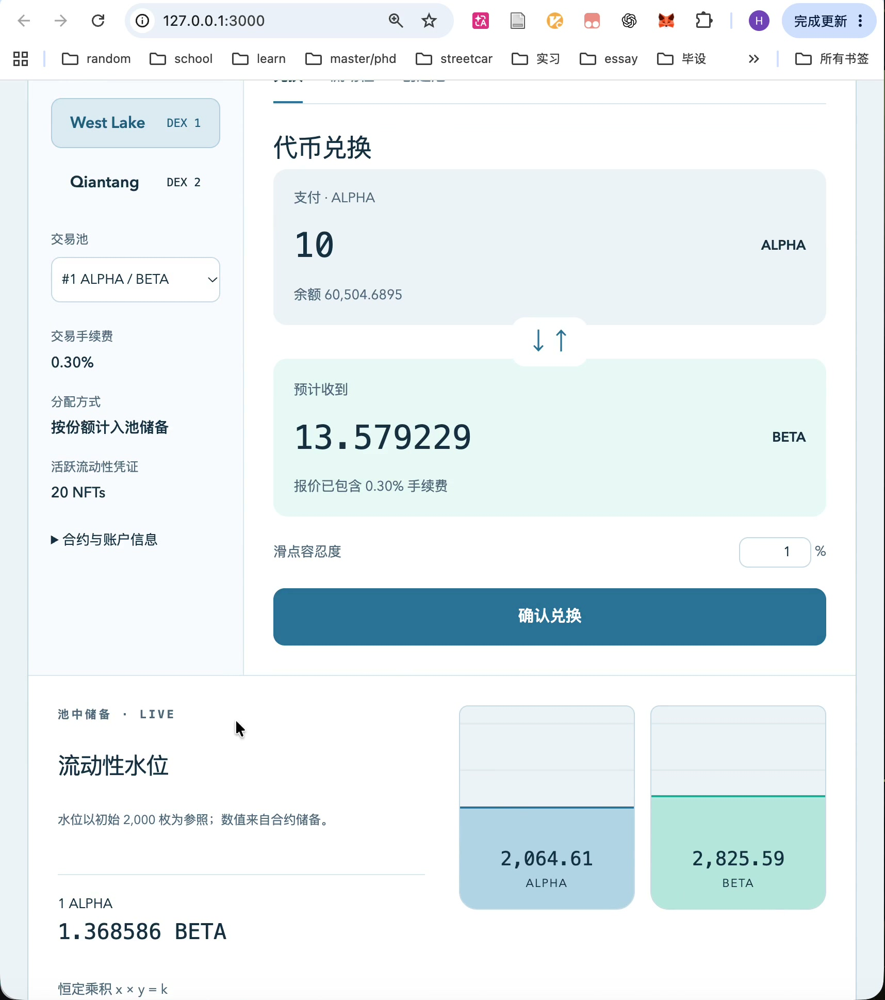
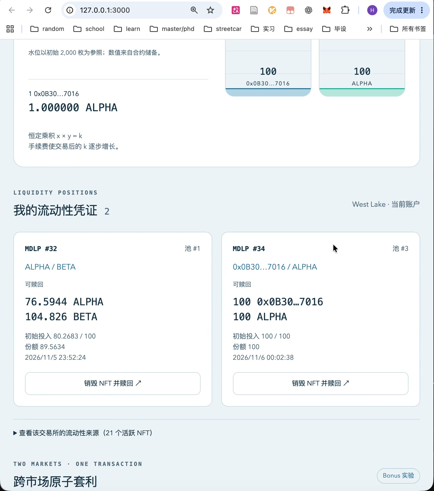
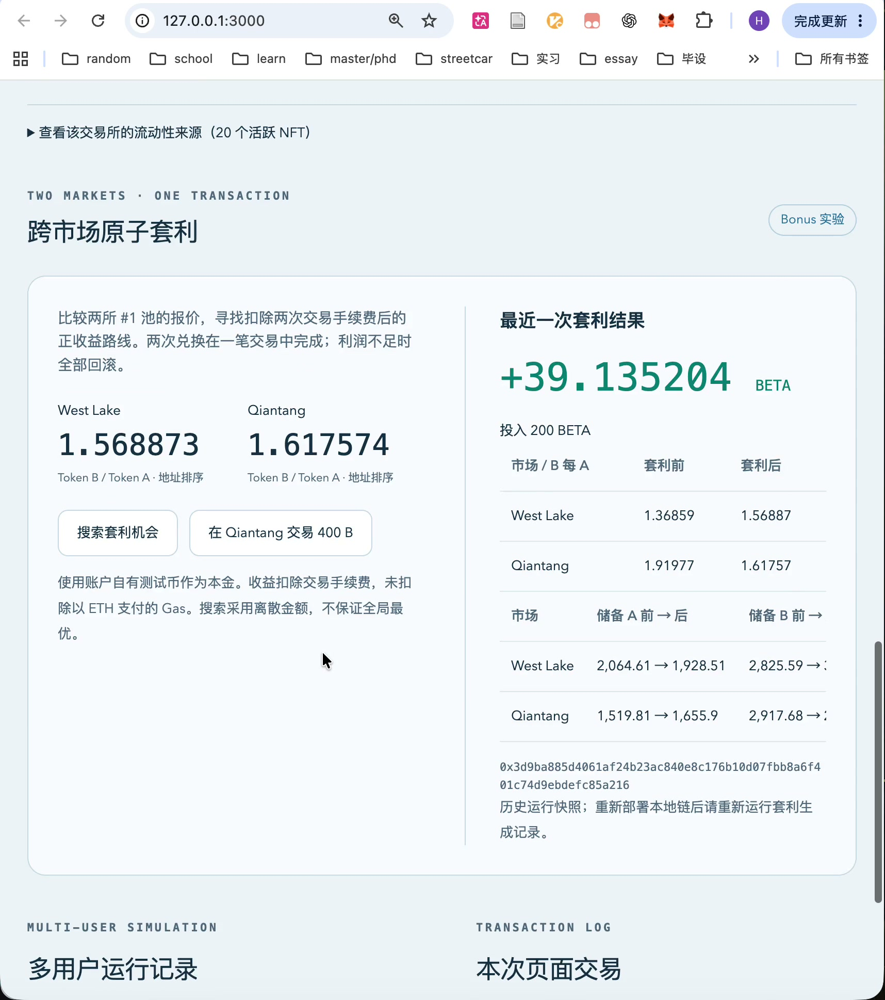

# Campus AMM · 链上交易实验室

浙江大学区块链课程第二次作业：基于恒定乘积 AMM 的去中心化交易所、ERC721 流动性凭证和跨交易所原子套利。项目基于助教提供的仓库 Fork 实现，运行在本地测试链，资产均为测试币。

## 功能与作业要求对应

| 要求                           | 实现与运行证据                                                                |
| ------------------------------ | ----------------------------------------------------------------------------- |
| 至少两种 ERC20、多账户分别领取 | ALPHA / BETA 水龙头，每次为调用账户增发 10,000 枚；本地节点为测试账户预置 ETH |
| 前端创建 AMM 池                | 用户输入两种 ERC20 地址建池；按地址排序，同一交易所内同币对去重               |
| 恒定乘积交易与手续费           | 根据实际储备计算报价，费率 0.30%，最低输出与截止时间保护                      |
| 添加/移除流动性、ERC721 NFT    | 每次添加铸造 NFT，记录池、份额、投入及时间；当前持有人销毁 NFT 赎回资产       |
| 流动性来源与个人凭证           | 展示原始提供者、当前持有人、初始投入、份额、时间及可赎回数量                  |
| 多用户随机模拟                 | 20 个不同地址，固定种子，四轮交易/添加及后续撤回；逐笔记录哈希并核对储备      |
| Bonus：两个交易所              | West Lake / Qiantang 独立部署，同一代币对分别维护独立储备和价格               |
| Bonus：原子套利                | 自动搜索双向报价，一笔交易内完成两次兑换，最低利润不足时整体 revert           |

[最终操作视频](docs/campus-amm-demo.mp4) · [实现分析](docs/implementation.md) · [验证记录](docs/validation.md) · [提交与视频内容索引](docs/submission.md)

## 环境与从零运行

Node.js 22.13+（22 系列）或 24/26、npm、Git。使用 Hardhat 本地节点，不需要公共测试网或 Ganache。Solidity 0.8.20 固定为 npm 依赖，通过本地 solc-js 编译。

```bash
git clone https://github.com/miss1994forever/ZJU-blockchain-course-2026.git
cd ZJU-blockchain-course-2026
npm run install:all
npm test
```

**终端一：启动测试链并保持运行。**

```bash
npm run node
```

**终端二：部署合约，启动前端。**

```bash
npm run deploy
npm run dev
```

打开终端打印的前端地址，默认 http://localhost:3000 。**8545 是区块链 JSON-RPC 接口端口，3000 是网页端口。**

部署脚本会自动创建两种代币、两个交易所和套利合约，在两个交易所各初始化一个 ALPHA/BETA 池，各存入两种代币各 2,000 枚，并导出 ABI 和地址到 `frontend/src/generated/`。

节点重启会清空链上状态，必须重新部署并刷新网页。仓库中的部署地址和运行报告属于本地运行记录，不代表公共链部署。

### 多用户模拟

保持节点运行，在另一个终端、项目根目录执行：

```bash
npm run simulate
```

20 个测试地址分别领取代币和授权，在两所的 #1 池中执行四轮随机操作并撤回部分 NFT。运行结束会核对整个交易所实际代币余额与各池储备合计，输出：

```text
Simulation complete: 20 users; ... Reserve balances verified.
```

报告写入 `docs/simulation-report.json` 和 `frontend/public/simulation-report.json`。网页点击「刷新数据」，查看「多用户运行记录」和流动性来源。次数为本轮统计，不是累计总量；固定种子下多轮运行的次数可能相同，余额和储备会继续变化。已烧毁的历史 NFT 会被跳过。

最终录屏对应的模拟报告为：20 个地址、43 次兑换、37 次添加、13 次撤回。报告是运行时快照，录屏后的操作不会倒写历史报告。

### 前端完整操作

1. 选择本地教学账户（例如账户 3），领取 ALPHA 和 BETA。
2. 选择 West Lake 的 #1 池，输入 10 ALPHA 并兑换，观察余额、储备和报价变化。
3. 若要展示创建新币对，执行下方的额外代币命令；使用终端打印的地址，与 ALPHA 地址在前端创建新池。
4. 添加流动性，查看铸造的 NFT 及流动性来源。可以先在同一个池交易，再查看可赎回资产变化。
5. 销毁对应 NFT，取回该份额的资产，凭证随之失效。销毁最后一个用户凭证后只剩极少量锁定流动性，不适合继续大额交易。
6. 在套利区域比较两所 #1 ALPHA/BETA 池的价格，制造价差、搜索并执行套利。

```bash
npm run extra-token
```

该命令部署额外的 18 位小数 GAMMA 代币，并给账户 3 发放 10,000 枚。**使用当次输出的代币地址，不要把用户账户地址当作代币地址。** 每执行一次会产生一个新合约；同币对不能在同所重复创建。

前端会把额外代币显示为缩写地址；池内 A/B 根据地址排序，A 不一定是名为 ALPHA 的代币。

### 原子套利

前端操作：点击「在 Qiantang 交易 400 B」形成价差，再点击「搜索套利机会」和「一笔交易执行套利」。前端搜索固定离散本金，不保证全局最优。

也可以执行脚本：

```bash
npm run arbitrage
```

脚本先通过普通交易制造价差，再比较两个方向、两种本金代币、1–300 整数本金的报价，执行搜索范围内利润最高的正收益路线。输出前后储备、价格、本金、利润、交易哈希和 Gas 用量，保存到 `docs/arbitrage-report.json` 与前端 public 目录。

最终视频中的套利使用 200 BETA 本金，输出约 239.135204 BETA，净增 **39.135204 BETA**。该结果已通过本地链交易回执和历史储备核对；完整数据见 [套利报告](docs/arbitrage-report.json)。利润已扣除两次 DEX 手续费，**未扣除以 ETH 支付的 Gas**。

### 钱包与检查命令

本地教学账户模式直接使用开发节点解锁的账户，不保存私钥。也实现了浏览器钱包连接：RPC `http://127.0.0.1:8545`，Chain ID `31337`，币种 ETH。最终录屏使用本地教学账户；本次未对 MetaMask 扩展进行实测。

```bash
npm test
npm run typecheck --prefix contracts
npm run build
```

前端生产包位于 `frontend/build/`，仍需本地节点与对应部署地址。

## 核心实现分析

- **交易公式**：`dy = floor(dx * 9970 * y / (x * 10000 + dx * 9970))`。输入全额进入储备，0.30% 手续费留在池中，交易后的恒定乘积逐步增长。
- **流动性份额**：首笔总份额为 `floor(sqrt(a*b))`，其中 1,000 个最小份额单位永久锁定；后续添加按当前比例取用用户最大投入量并计算份额，多余代币不转入。
- **NFT 赎回**：每个 NFT 对应一笔独立份额。赎回量为该份额占总份额比例对应的当前储备；NFT 可以转移，赎回权属于当前持有人。销毁后不能再次赎回。
- **手续费分配**：全部留在储备，已有份额按比例分享，撤回时随对应资产兑现。赎回额与初始投入的差异还包含价格变化，不能直接全部称为手续费收入。
- **原子性**：链下搜索只负责报价；`AtomicArbitrage.execute` 在一次链上交易中调用两个池。最终输出须覆盖本金、满足最低利润且利润为正，否则 revert 恢复两次兑换涉及的状态。
- **保护与边界**：SafeERC20、重入保护、滑点和截止时间检查、uint112 储备上限。支持普通 ERC20；前端支持 18 位小数，不支持收费转账、重基等非标准行为。不实现闪电贷、V3 集中流动性或同所三角套利。

详细设计见 [实现说明](docs/implementation.md)。

## 最终视频与截图

最终视频由提交者自行录制：约 **1 分 33 秒**，原分辨率 **1716 × 1938**，压缩为 H.264 / 20 fps，无音轨。压缩保留全部操作内容，未剪切或替换页面状态。

[下载最终操作视频](docs/campus-amm-demo.mp4)。截图均从该视频提取，并实际保存在本仓库。

| 内容                   | 视频位置（约） | 截图                                                                                                                                            |
| ---------------------- | -------------- | ----------------------------------------------------------------------------------------------------------------------------------------------- |
| 账户与领取测试币       | 0–11 秒        | [账户余额](docs/screenshots/submission/account.jpg)                                                                                             |
| 代币兑换与储备变化     | 11–23 秒       | [兑换](docs/screenshots/submission/swap.jpg)                                                                                                    |
| 前端创建新交易池       | 23–31 秒       | [创建池](docs/screenshots/submission/create-pool.jpg)                                                                                           |
| 添加流动性、NFT 与赎回 | 31–53 秒       | [流动性](docs/screenshots/submission/liquidity.jpg)、[NFT](docs/screenshots/submission/nft.jpg)、[赎回](docs/screenshots/submission/redeem.jpg) |
| 多用户记录与套利       | 53–84 秒       | [运行统计](docs/screenshots/submission/simulation.jpg)、[套利结果](docs/screenshots/submission/arbitrage.jpg)                                   |
| 不同用户的流动性来源   | 84–93 秒       | [来源列表](docs/screenshots/submission/sources.jpg)                                                                                             |

### 兑换



### 流动性凭证



### 原子套利



## 目录

```text
contracts/contracts/      ERC20、AMM/NFT、原子套利合约
contracts/scripts/        部署、模拟、套利、额外代币脚本
contracts/test/           合约正确性、赎回权限和失败回滚测试
frontend/src/             React 页面、部署生成的 ABI 与地址
deployments/              本地部署记录
docs/                     实现分析、验证记录、视频、截图及运行报告
```

## 提交

公开仓库：https://github.com/miss1994forever/ZJU-blockchain-course-2026

按课程要求提交公开仓库链接和压缩后的视频。视频文件名及邮件主题使用 `学号_姓名_作业2`；源码、README 和截图均在仓库中。邮件发送由提交者完成。

## 参考与 AI 使用说明

- [助教原始框架](https://github.com/LBruyne/ZJU-blockchain-course-2026)：Fork 后保留并扩展 Hardhat / React / TypeScript 项目结构。
- [Uniswap 手续费模型](https://developers.uniswap.org/docs/get-started/concepts/fees)：参考恒定乘积 AMM 与手续费计入储备的机制；项目没有实现协议抽成。
- [OpenZeppelin Contracts](https://docs.openzeppelin.com/contracts/5.x/)：使用 ERC20、ERC721、SafeERC20、ReentrancyGuard、Math、Base64 等标准组件。
- AI 参与了方案设计、主要新增代码的生成和修改、测试及文档整理；提交者进行了页面操作、练习和最终视频录制。本项目未引用其他同学的作业，参考来源如上列明。
