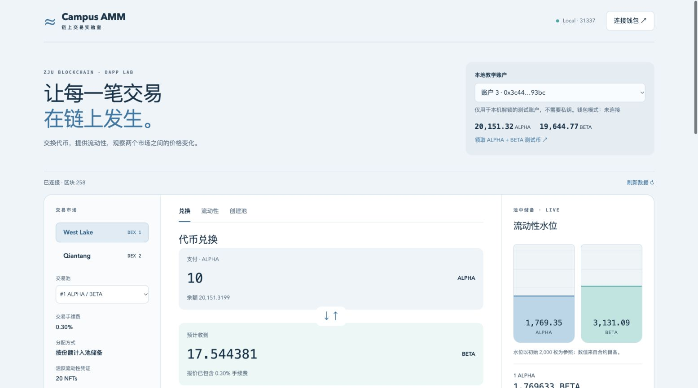
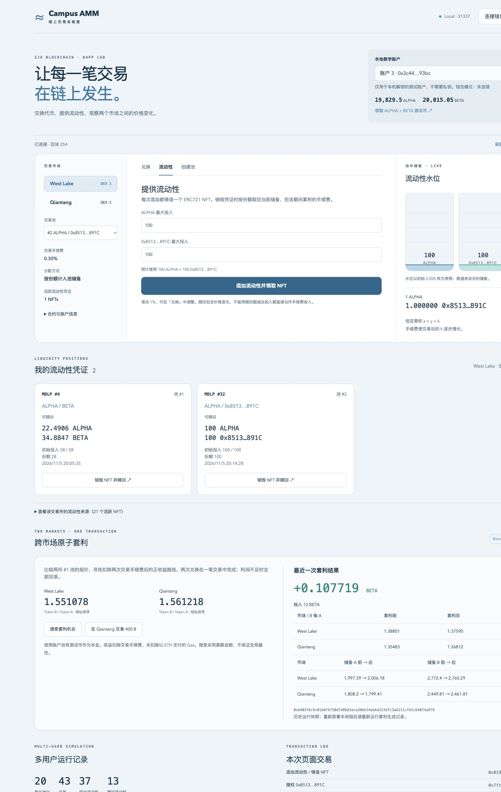
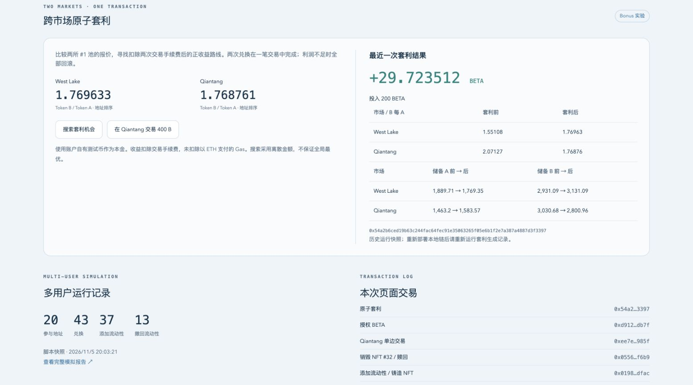

# Campus AMM · 链上交易实验室

浙江大学区块链课程第二次作业。在助教提供的框架上实现基于恒定乘积 AMM 的 DEX、NFT 流动性凭证、20 地址模拟，以及双交易所原子套利。

> 本项目仅在本地测试链运行。所有代币和 ETH 均为测试资产。

## 功能

| 作业要求                   | 实现                                                                 |
| -------------------------- | -------------------------------------------------------------------- |
| 至少两种 ERC20、多账户领取 | ALPHA / BETA，账户独立调用 faucet；开发节点为账户预置测试 ETH        |
| 前端创建池与交易           | 支持普通 ERC20 建池、0.30% 手续费、储备与报价展示、滑点保护          |
| 添加/撤回流动性与 ERC721   | 每次添加铸造 NFT，包含池、份额、投入、时间；销毁赎回当前份额和手续费 |
| 查看流动性来源与个人 NFT   | 原始提供者、当前所有者、初始投入、份额、时间、可赎回资产             |
| 多用户模拟                 | 20 地址、固定种子、多轮交易/添加/撤回，报告记录哈希并验证储备        |
| Bonus：多个交易所          | West Lake / Qiantang 两个独立 MiniDEX 实例，相同代币对的独立池       |
| Bonus：原子套利            | 自动报价搜索，一笔交易内完成两次兑换，无利润/最低利润不足整笔回滚    |

## 环境

- Node.js 22.13+（22 系列）或 24/26；npm；Git。
- 默认使用 Hardhat 本地节点，无需 Ganache 或公共测试网。
- 钱包可选：可以直接选择本地节点解锁的教学账户完成操作，也保留浏览器钱包连接。

## 从零运行

```bash
git clone https://github.com/miss1994forever/ZJU-blockchain-course-2026.git
cd ZJU-blockchain-course-2026
npm run install:all
npm test
```

在**终端一**启动本地链，保持运行：

```bash
npm run node
```

在**终端二**部署并启动前端：

```bash
npm run deploy
npm run dev
```

打开 http://localhost:3000 。部署脚本会自动导出 ABI、地址到 `frontend/src/generated/`，并在两所分别创建与注入 ALPHA/BETA 池，各投入两种币各 2,000 枚。

重新启动节点会清空链上状态，必须重新运行 `npm run deploy`。仓库中的部署地址和报告是一次本地运行的记录，不代表任何公共链部署。不要对仍在使用的链重复部署后继续操作旧页面。

### 多用户模拟与套利

保持节点运行，在项目根目录执行：

```bash
npm run simulate
npm run arbitrage
```

- 模拟使用 20 个地址，执行四轮操作并撤回部分 NFT；剩余 NFT 可以在前端切换账户查看。
- 套利脚本先通过普通交易制造价差，再扫描两个方向、两种本金代币、1–300 整数本金，选择范围内最佳正收益路线并调用原子套利合约。
- 输出报告到 `docs/*-report.json` 和 `frontend/public/*-report.json`。前端点击「刷新数据」读取报告。
- 报告利润已扣除两次 DEX 手续费，未扣除 ETH Gas；报告独立记录 gasUsed。

### 前端操作流程

1. 选择一个本地教学账户，点击「领取 ALPHA + BETA 测试币」。
2. 在 West Lake 的 ALPHA/BETA 池输入金额并兑换，观察储备及报价变化。
3. 切换「流动性」，填写两种币的最大投入量，添加后查看「我的流动性凭证」。
4. 查看 NFT 对应的初始投入、份额、时间及可赎回额；在其他账户交易后，销毁 NFT 取回当前资产。
5. 展开流动性来源，观察各用户的 NFT 与投入记录。
6. 查看 West Lake / Qiantang 的价格，点击「在 Qiantang 交易 400 B」制造价差，然后「搜索套利机会」并「一笔交易执行套利」。
7. 查看前后价格、储备、利润和交易哈希。

两种代币按地址排序为池内 A / B，A 不一定是名称 ALPHA，请以界面标注为准。创建新池时输入两种不同的 ERC20 地址；同所同币对不能重复建池，可运行 `npm run extra-token` 部署第三种 TestToken（GAMMA），终端会打印地址并给账户 3 发放 10,000 枚，再用账户 3 创建其他币对。

### 钱包模式

连接本地网络：RPC `http://127.0.0.1:8545`、Chain ID `31337`、币种 ETH。使用 Hardhat 节点显示的**开发账户**进行演示，也可自行创建钱包并用本地解锁账户转入测试 ETH。不要导入真实资产账户作为开发账户。

### 检查与构建

```bash
npm test
npm run typecheck --prefix contracts
npm run build
```

Solidity 0.8.20 已作为 npm 依赖固定，编译使用本地 solc-js，无需额外下载编译器。前端生产包位于 `frontend/build/`；即便使用生产包，仍需本地节点与正确部署地址。

## 目录与实现分析

```text
contracts/contracts/TestToken.sol        ERC20 水龙头
contracts/contracts/MiniDEX.sol          多池 AMM、NFT 份额、费用与赎回
contracts/contracts/AtomicArbitrage.sol  原子套利
contracts/scripts/                      部署、随机模拟、套利搜索
contracts/test/testMiniDEX.ts            合约与回滚测试
frontend/src/App.tsx                     React 交互界面
frontend/src/generated/                  部署脚本输出 ABI 与本地地址
docs/implementation.md                  公式、份额与设计边界
docs/*-report.json                       运行证据
```

完整公式与功能分析见 [实现说明](docs/implementation.md)，验证结果见 [验证记录](docs/validation.md)，录制顺序见 [视频演示脚本](docs/demo-script.md)。

## 截图

截图文件保存在仓库 `docs/screenshots/`，展示实际链上交互，不依赖外部图片地址。







## 实际操作视频

[下载约 1 分 43 秒的演示 MP4](docs/campus-amm-demo.mp4) · [中文字幕 SRT](docs/campus-amm-demo.srt)

视频为实际浏览器操作的低帧率录屏，无旁白，MP4 内含默认中文字幕轨；播放器如未显示字幕可加载 SRT。展示领币、兑换、创建新池、添加流动性、NFT 赎回、套利与多用户报告。视频录制时的模拟报告另存为 `docs/simulation-demo-report.json`，后续重复运行报告可能不同。视频使用额外部署的 GAMMA 测试建池，其地址在重新部署时可能变化。

## 提交

- 公开仓库链接：https://github.com/miss1994forever/ZJU-blockchain-course-2026
- 随仓库提供 README、实现说明和实际运行截图。
- 单独录制 1–2 分钟视频，完整展示启动后的核心操作、链上交互和套利结果；文件名按课程要求使用「学号*姓名*作业2」。
- 邮件提交使用课程指定收件地址；不要将源码作为压缩包代替公开仓库链接。

## 参考与 AI 辅助

- [助教原始框架](https://github.com/LBruyne/ZJU-blockchain-course-2026)：保留 Hardhat / React / TypeScript 项目结构与环境配置。
- [Uniswap 费用模型](https://developers.uniswap.org/docs/get-started/concepts/fees)：恒定乘积交易与手续费计入储备的思路。项目未实现协议抽成。
- [OpenZeppelin Contracts](https://docs.openzeppelin.com/contracts/5.x/)：ERC20、ERC721、SafeERC20、ReentrancyGuard、Math、Base64。
- 使用 AI 辅助设计、编写及验证；提交者应理解合约状态变化、份额计算与原子回滚机制，并按课程规则说明使用情况。
